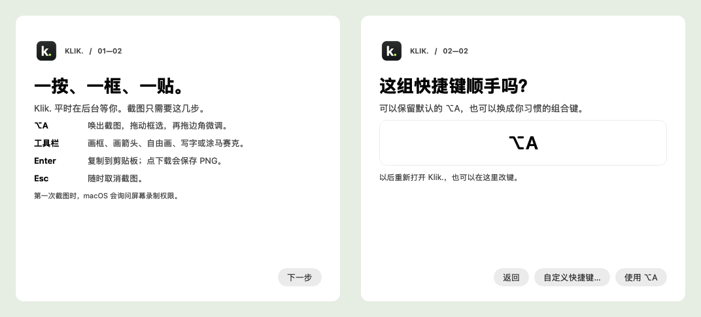
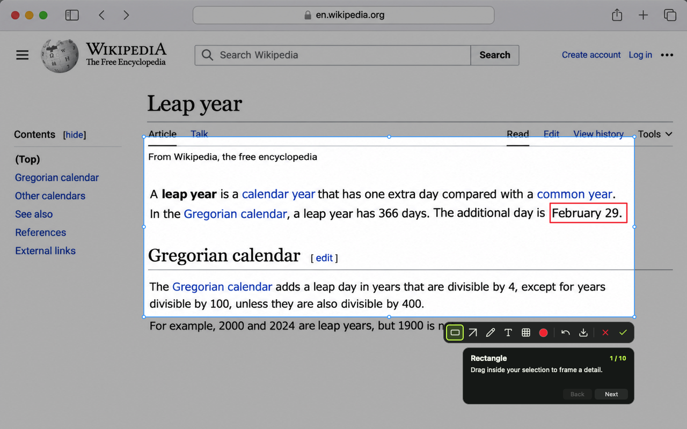

<p align="center">
  
</p>
<h1 align="center">Klik.</h1>
<p align="center">A quiet, native screenshot tool for Mac. Capture a region, mark it up, and paste it.</p>
<p align="center">
  <a href="README.zh-CN.md">简体中文</a> ·
  <a href="https://github.com/TerryZheng233/Klik/releases/latest">Download DMG</a> ·
  Apple silicon · macOS 14+
</p>


Klik. waits in the background. Press your shortcut to frame part of the screen, adjust the edges, and add a rectangle, arrow, pen stroke, text, or freehand pixelation. Press **Enter** to copy the marked-up image and get back to what you were doing.

## Get started

1. Download the [latest DMG](https://github.com/TerryZheng233/Klik/releases/latest), open it, and drag **Klik.app** into **Applications**.
2. Open Klik. from Applications. Choose **下一步** (Next), then **使用 ⌥A** to keep the default or **自定义快捷键…** to record your own.
3. Use the shortcut to start a capture. On the first capture, macOS asks for **Screen & System Audio Recording** access. Reopen Klik. if macOS asks you to.

<p align="center">
  
</p>

## Choose a shortcut that feels right

Reopen Klik. from Applications whenever you want to change the shortcut. If a combination is in use, Klik. asks you to try another one and keeps your existing shortcut.



*The setup figure shows the Simplified Chinese interface in 0.1.7.*

## Language and appearance

In 0.1.8, Klik. follows your system’s preferred language by default. To switch instantly, reopen Klik. and choose **Follow System**, **English**, or **简体中文** under **Language**. The guide and settings also adapt to macOS light and dark appearance.


## Take a practice capture

In 0.1.9, the first-run guide starts with **⌥A**. If macOS asks for screen recording access, grant it and return to the guide. Drag a selection to reveal the toolbar. The guide highlights each button in turn, and you can use the tools as you go.



Press **Enter** to copy your capture or **↓** to save a PNG. Klik. then asks whether you want to keep the shortcut or record a different one. **Esc** returns to the practice screen. Reopen Klik. and select **Practice a Capture…** to do it again.

## While you capture

| Control | What it does |
| --- | --- |
| **⌥A** (default) | Start a region capture on the display under the pointer |
| **Click a window** (0.1.12+) | Hover to preview its boundary, then click to select it |
| **Click the desktop** or **Shift-click** (0.1.12+) | Select the whole display |
| **Drag an edge or corner** | Adjust the selected region |
| **Enter** or **green ✓** | Copy the finished image to the clipboard |
| **↓** | Save a PNG to Downloads |
| **Esc** or **red ×** | Cancel the capture |
| **⌘Z** | Undo the last mark |

The rectangle, arrow, pen, and text tools share eight colors. Captures use the display's pixel resolution and stay on one display. Klik. processes captures locally and has no Dock or menu bar icon while idle.

To launch at sign-in, add Klik.app under **System Settings → General → Login Items → Open at Login**.

## Build from source

Requires Swift 5.10 or later and the macOS 15 SDK or later.

```sh
swift test
./build-app.sh
open -g .build/Klik.app
```

The private release uses ad hoc signing and has not been notarized by Apple. macOS may block a downloaded copy on first launch. A new build may also require screen recording permission again. [Apple notarization documentation](https://developer.apple.com/documentation/security/notarizing-macos-software-before-distribution)

For local updates, the build uses the **Apple Development** identity when exactly one is available in Keychain. Set `KLIK_SIGN_IDENTITY` to select a specific identity. Keep the same signing identity across updates to retain the app’s macOS permissions.

To make the same drag-to-install disk image after building the app, use [dmgbuild 1.6.7](https://pypi.org/project/dmgbuild/1.6.7/):

```sh
dmgbuild -s Packaging/dmg-settings.py \
  -D app=.build/Klik.app -D background=Packaging/background.png \
  'Klik.' Klik-0.1.7-arm64.dmg
```

Toolbar icons are from [Lucide](https://lucide.dev/icons/). See the [included license](Resources/Lucide/LICENSE).
