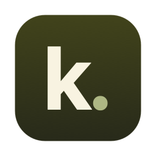
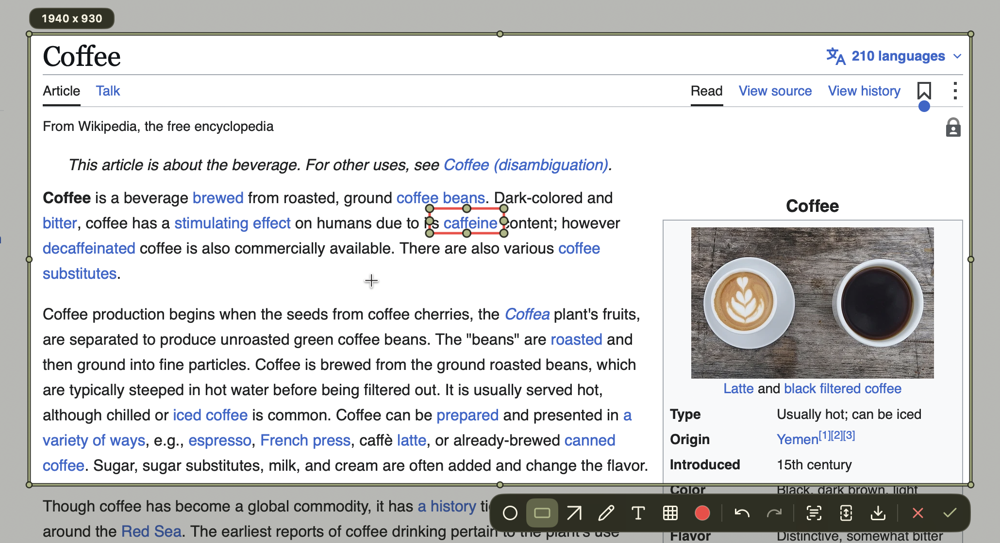
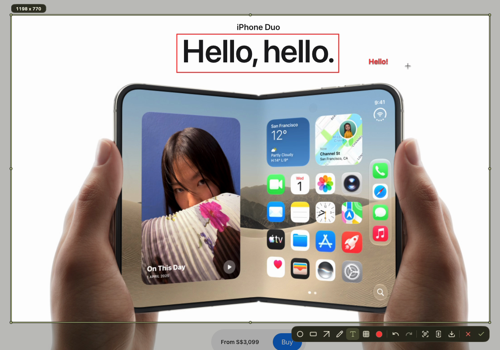
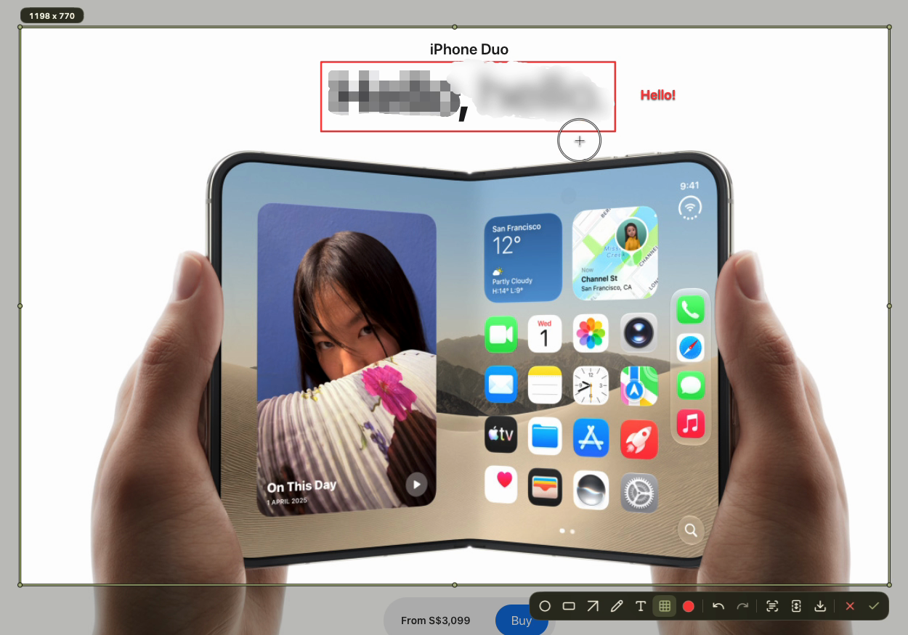
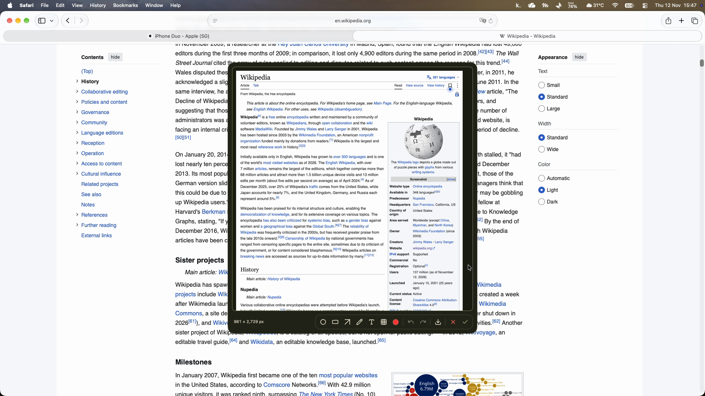
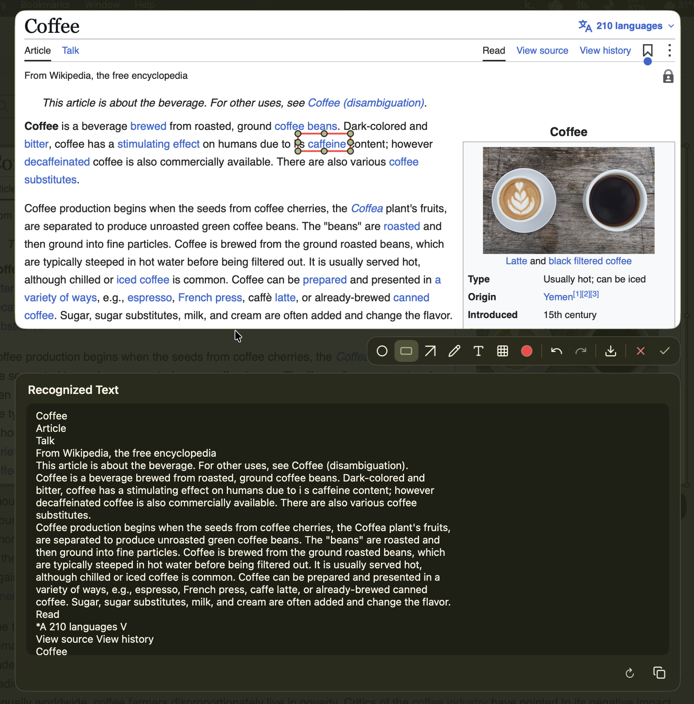
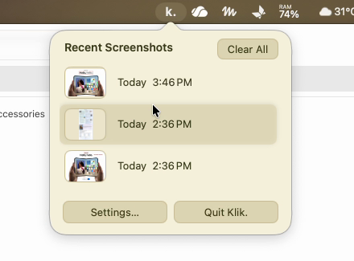
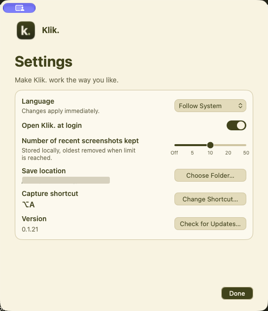

<p align="center">
  
</p>
<h1 align="center">Klik.</h1>
<p align="center">Take a screenshot. Keep your train of thought.</p>
<p align="center">
  <a href="README.zh-CN.md">简体中文</a> ·
  <a href="CHANGELOG.md">Changelog</a> ·
  <a href="https://github.com/TerryZheng233/Klik./releases/latest">Download DMG</a> ·
  Apple silicon · macOS 14+
</p>

https://github.com/user-attachments/assets/99764191-c641-44bc-b292-a2fe8ec5a89e

Press **⌥A**, or set a shortcut you like. Select an area, add annotations if you need them, then press **Enter** or double-click the selection with no annotation tool active. Boom, it’s in your clipboard, ready to paste. You can recognize text, too.



*Select an area, then use the toolbar to mark it up before copying or saving.*

## What you can do

- **Capture and copy:** Pick an area, display, or window, then paste your screenshot wherever you need it.
- **Capture while scrolling:** Stitch a long page or a wide view as you scroll. You can reverse direction during the same capture.
- **Mark it up:** Add circles, boxes, arrows, text, or pen strokes to a regular or stitched screenshot. Cover details with pixelation, a soft brush, or a solid color, and pick colors straight from the image.
- **Pick out text:** Review and edit text recognized on your Mac alongside the screenshot, then copy it or carry on marking up the image.
- **Save it for later:** Save a PNG to a folder you choose, or keep a history of recent screenshots on your Mac.

## Why I made Klik.

I love how easy it is to take a screenshot in WeChat. But confirming one always brings the WeChat window to the front, and macOS saves screenshots to the desktop by default, which slowly turns into a mess over time. I made Klik. because I wanted to capture something, paste it, and carry on without losing my place or collecting files I don’t need.

## Choose what to capture

| Do this | What happens |
| --- | --- |
| **Drag** | Frame part of the screen. Pull an edge or corner to adjust the selection |
| **Hold Shift while selecting** | Keep the region square. Its pixel dimensions update at the top left |
| **Click before selecting** | Select the whole display under your pointer |
| **Hold Space and click** | Select a window, including the parts another window covers |
| **Double-click** | Copy an empty part of the selection when no annotation tool is active. Double-click text to edit it. Hold Space and double-click to copy a window |
| **Enter** or **✓** | Copy the screenshot with your annotations |
| **Save PNG button (↓)** | Save a PNG in the selected folder (Downloads by default) |
| **Esc** or **×** | Cancel the capture |
| **⌘Z** | Undo your last annotation |
| **⇧⌘Z** | Redo an annotation you just undid |
| **Recognize Text** | Recognize text on this Mac, then review or edit it before copying |
| **Scroll over the capture** | Adjust the selected annotation or current tool’s size |
| **Hold Shift while drawing** | Draw a straight pen or mosaic stroke, a circle, a square, or an arrow snapped to 45° |

Want to capture a partly covered window? Hold **Space**, point to any visible part, and click to select the full window. A magnifier appears as you drag or adjust a selection, so you can line up the edges. With no annotation tool selected, move the pointer inside the selection and drag to reposition it. If you have multiple displays, move the pointer to the display you want to capture.

Click a box, arrow, text, or pen mark to show its outline or handles, then drag it to move it. Drawing near an unselected mark creates a new mark. Double-click text to edit it; select an annotation and choose a color to change it. Scroll over the capture to adjust the active tool’s stroke width or text size. Select an existing mark first to adjust that mark. In a scrolling screenshot preview, hold **Option** while scrolling to adjust; scroll normally to browse. You can resize a box using its handles or adjust an arrow by dragging an endpoint, or bend it by dragging its middle handle. When adding text, press **Enter** once to finish editing and again to copy the screenshot.





Some apps may prevent their windows from appearing in screenshots. On some Macs, this can include WeChat, even when its window is visible on screen.

To move or remove a cover stroke, click it to select it, then drag it or press **Delete**. Press **⌘Z** to restore it. In recent screenshot previews, choose **Delete**, then **Confirm** to remove one image.

## Scrolling screenshots

1. Frame the part of the page or app that scrolls, then click **Scrolling Screenshot** in the toolbar.
2. Scroll inside the selection at a steady pace. The first detected movement sets the axis. You can scroll up and down or left and right, including reversing direction on that axis.
3. Click **Done** to review the stitched image. Scroll through it and add any markup you need. Press **Enter** or click **✓** to copy it, or use **↓** to save a PNG at its full stitched resolution.



## Recognize text

Select an area and choose **Recognize Text**. Klik. uses Apple’s Vision framework on your Mac and shows the result beside the image. You can edit or copy the text and keep using the markup tools.



*The recognized text can be edited before copying; check it against the image.*

Klik. recognizes text from the selected image and its annotations. If you add or undo mosaic, unedited results refresh automatically. If you’ve edited the text, Klik. keeps your changes and warns that they may still include covered content. The refresh button asks before replacing your edits. Check the text before sharing, especially after covering information or when working with formulas and tables.

In the OCR view, **Copy Text** keeps the editor open. The download button or **Enter** saves the image; while editing text, **Enter** inserts a line and **⌘Enter** saves the image.

Before sharing sensitive information, please check the finished image. Pixelation and blur may not fully conceal the original content; a solid cover is the clearer option.

## Install Klik.

Klik. currently supports **Apple silicon Macs running macOS 14 or later**. The download does not support Intel Macs.

1. Go to the [latest release](https://github.com/TerryZheng233/Klik./releases/latest). Under **Assets**, download the file ending in **`arm64.dmg`** (expand Assets if needed), not the `.sha256`, `.sig`, or source code files.
2. Open the DMG, then drag **Klik.app** into **Applications**. Open Klik. from Applications. If macOS says it can’t verify the app, see [If macOS blocks Klik.](#if-macos-blocks-klik) below.
3. The first-run guide will appear. Press **⌥A** or click **Start Practice**. When prompted, allow **Screen & System Audio Recording**; if macOS asks you to reopen Klik., do so and return to the guide.
4. Follow the guide to select and copy a screenshot, then keep **⌥A** or choose another shortcut. Once you’re set up, use your shortcut to select an area, then press **Enter** or double-click the selection with no annotation tool active to copy it. Paste with **⌘V**.

### Install with an agent

If you’d like an agent to help with setup, paste this into a chat with one that can use your Mac and access GitHub:

```text
Help me install the latest Klik. release on this Mac from:
https://github.com/TerryZheng233/Klik./releases/latest

1. Check that my Mac has Apple silicon and runs macOS 14 or later. Find the latest release and download its DMG and matching SHA-256 file. If you cannot access the release or find both files, explain what is blocking you. Verify the DMG against the checksum and stop if it does not match.
2. Mount the DMG, copy Klik.app to /Applications, check that the installed version matches the release, and eject the DMG. If Klik.app is already installed, ask me before replacing it.
3. Guide me through first launch. If macOS blocks the app, show me the relevant Apple instructions and let me decide how to proceed. Leave system security settings as they are.
4. Help me try the capture shortcut and grant screen recording access when prompted. If the shortcut is already in use, help me choose another one.
```

### If macOS blocks Klik.

The GitHub release is ad hoc signed and **has not yet been notarized by Apple**, so macOS may say it cannot verify that Klik. is free of malware. If you downloaded Klik. from this repository, are confident it has not been altered, and decide to open it:

1. Dismiss the warning, then open **System Settings → Privacy & Security**.
2. Scroll down to **Security** and find the message that Klik.app was blocked. Click **Open Anyway**, then follow the system prompts. You may need your Mac password or Touch ID.
3. Open Klik. again if it does not start automatically. The button may only appear after you have tried to open the app and may be available for a limited time.

These steps create an exception for the app. If you don’t see the option, or your Mac is managed by a school or employer, it may not be available. If macOS says the app is damaged or will harm your computer, do not open it; check the download and see [Apple’s instructions for opening apps safely](https://support.apple.com/en-us/102445).

### If screenshots don’t work

- **Screen recording permission:** Open **System Settings → Privacy & Security → Screen & System Audio Recording** and allow Klik. If it isn’t listed, try starting a screenshot first. If it still isn’t listed, use the **+** button and select **Applications → Klik.app**. Restart Klik. if prompted. macOS may ask for permission again after an update.
- **Shortcut conflict:** If **⌥A** is already used by another app, use **Start Practice** in the first-run guide, then choose another shortcut. You can also change it later via **k. → Settings → Change Shortcut**. Both apps may not be able to use the same shortcut at the same time.
- **A window is missing:** Some apps restrict screen capture. On some Macs, WeChat windows may not appear even when visible on screen.

## Recent screenshots and settings

Find your recent screenshots under **k.** in the menu bar. They’re stored on your Mac, and you can select one to preview or copy it again. To clear the list, click **Clear All**, then click the red **Confirm** button in the same spot. Klik. keeps 10 by default. In settings, you can turn off new history or change the limit to 5, 10, 20, or 50 screenshots. Turning it off keeps existing history until you clear it. When the limit is reached, the oldest captures are removed.



In settings, you can also have Klik. open at login and check for updates. When a new version is available, you can install it there and restart Klik. Starting with 0.1.19, Klik. verifies an independent update signature before installing. GitHub releases use ad hoc app signing, so macOS may request screen recording permission again after an update.

You can also change your shortcut in settings, or choose **Follow System**, **English**, or **简体中文** under **Language**. The olive-and-cream palette runs through the app, including the guide, settings, and capture tools. The guide, settings, and scrolling capture prompt follow your Mac’s light or dark appearance.

<p align="center"></p>

*The local save path is obscured in this screenshot.*

## Build from source

Use Swift 5.10 or newer and the macOS 15 SDK or newer.

```sh
swift test
./build-app.sh
open -g .build/Klik.app
```

If iCloud Drive or another sync service adds Finder metadata that breaks signature verification, pass an unsynced output directory to `./build-app.sh`, such as `./build-app.sh "$(mktemp -d /tmp/klik-build.XXXXXX)"`.

The GitHub DMG is ad hoc signed and hasn’t been notarized. macOS may block it on first launch or ask for screen recording access again after an update. For local builds, the script uses the **Apple Development** identity if there’s exactly one in Keychain. Set `KLIK_SIGN_IDENTITY` to pick one yourself. Using the same identity for local updates helps retain the existing permission. [Apple code signing requirements](https://developer.apple.com/documentation/technotes/tn3127-inside-code-signing-requirements)

To make a drag-to-install DMG, use [dmgbuild](https://pypi.org/project/dmgbuild/1.6.7/).

```sh
KLIK_SIGN_IDENTITY=- ./build-app.sh .build/distribution
dmgbuild -s Packaging/dmg-settings.py \
  -D app=.build/distribution/Klik.app -D background=Packaging/background.png \
  'Klik.' Klik-build-arm64.dmg
```

## Screenshot credits

The capture and text recognition examples show the [Wikipedia article “Coffee”](https://en.wikipedia.org/wiki/Coffee), excerpted under [CC BY-SA 4.0](https://creativecommons.org/licenses/by-sa/4.0/). The coffee photograph is by [Bex Walton](https://commons.wikimedia.org/wiki/File:Latte_and_dark_coffee.jpg), under [CC BY 2.0](https://creativecommons.org/licenses/by/2.0/). Screenshots were cropped and annotated. The live demonstrations also show the [Wikipedia article “Wikipedia”](https://en.wikipedia.org/wiki/Wikipedia) and the [Apple website](https://www.apple.com/).

## License

Klik. is available under the [MIT License](LICENSE). Toolbar icons are from [Lucide](https://lucide.dev/icons/) and retain their [own license](Resources/Lucide/LICENSE).
