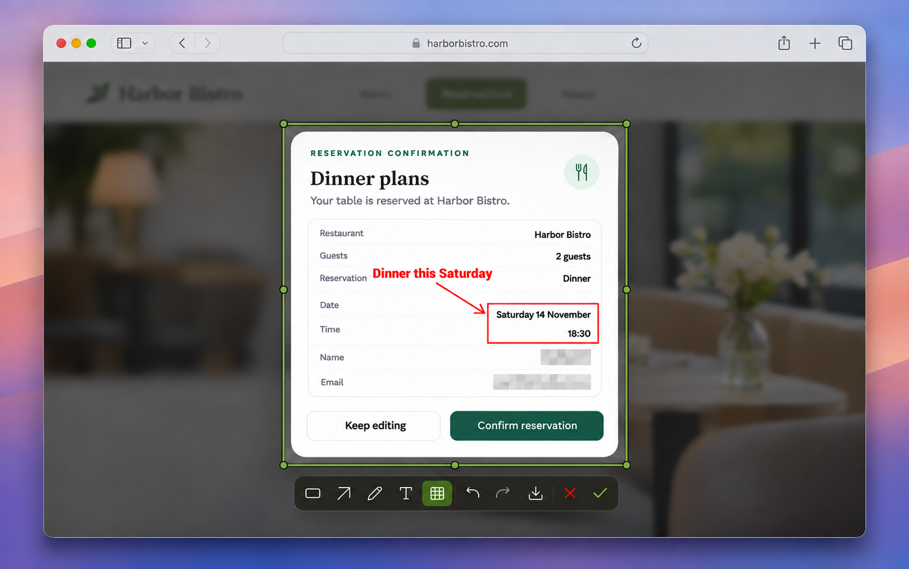

<p align="center">
  
</p>
<h1 align="center">Klik.</h1>
<p align="center">随手截一张，思路不断。</p>
<p align="center">
  <a href="README.md">English</a> ·
  <a href="CHANGELOG.md">更新日志</a> ·
  <a href="https://github.com/TerryZheng233/Klik./releases/latest">下载 DMG</a> ·
  Apple 芯片 · macOS 14+
</p>

按 **⌥A** 或你自己设置的快捷键，框选区域，再按 **Enter** 或双击选区复制。双击复制适用于未选中标注工具的情况。需要时加上标注或识别文字，然后继续手头的事。



*示意图使用虚构信息；工具栏可能与当前版本略有不同。*

## 能做什么

- **截图并复制**：选一个区域、一块屏幕或一个窗口，截完就可以粘贴到需要的地方。
- **随手标注**：画框、箭头、文字或笔迹；用像素马赛克、柔和笔刷或纯色遮盖细节，也可以直接从图片中取色。
- **识别文字**：在截图旁查看和编辑 Mac 本机识别出的文字，复制后也可以继续标注图片。
- **留下需要的截图**：把 PNG 存到自己选的文件夹，也可以选择在本机保留最近截图。

## 为什么做 Klik.

我很喜欢微信截图的方便，但确认截图后有时会切回微信；Mac 自带截图则默认保存到桌面。所以我做了 Klik.：想截的时候截一张，粘贴后继续做手头的事，也不用留下不需要的文件。

## 截一块、截整屏或截窗口

| 怎么操作 | 会发生什么 |
| --- | --- |
| **拖动** | 框选屏幕的一部分。想微调就拖边缘或四角 |
| **还没有选区时单击** | 选中鼠标所在的整块显示器 |
| **按住空格并单击** | 选中一个窗口，连被挡住的部分也能截到 |
| **双击** | 未选中标注工具时，双击选区即可复制。按住空格双击窗口，可以直接复制窗口截图 |
| **Enter** 或 **✓** | 把带标注的截图复制到剪贴板 |
| **「下载 PNG」按钮（↓）** | 把 PNG 存到所选文件夹（默认为「下载」） |
| **Esc** 或 **×** | 取消截图 |
| **⌘Z** | 撤销上一笔标注 |
| **⇧⌘Z** | 重做刚刚撤销的标注 |
| **「识别文字」按钮** | 在本机识别当前选区，检查或编辑结果后复制文字 |
| **在马赛克画笔上滚动** | 调整画笔粗细 |
| **绘制时按住 Shift** | 用画笔或马赛克画直线、画正方形，或将箭头吸附到 45° 角度 |

想截被挡住的窗口，按住**空格**，把鼠标移到窗口露出来的部分。点一下，整个窗口就会出现在选区里。框选或调整边界时会出现放大镜，方便对准细节。没有选中标注工具时，把鼠标移到选区内就可以拖动选区。如果连接了多台显示器，把鼠标移到想截图的屏幕即可。

绘制后可以拖动框、箭头、文字或笔迹来调整位置；拖动矩形的边角可以改变大小，拖动箭头端点可以调整方向和长度。添加文字时，按一次 **Enter** 确认文字，再按一次复制截图。

有些应用的窗口可能无法出现在截图中。在部分 Mac 上，微信即使显示在屏幕上，也可能遇到这种情况。

## 识别文字

框选好区域，点击「**识别文字**」就可以了。Klik. 使用 Apple 的 Vision 框架在本机识别，并在截图旁显示结果。你可以编辑、复制文字，也可以继续给图片添加标注。

识别使用当前截图和已有标注。添加或撤销马赛克后，未编辑的结果会重新识别；已编辑的文字会保留，并提示其中可能仍有已被遮盖的内容。点击重新识别时，Klik. 会先确认是否替换编辑内容。分享前请检查结果，尤其是遮盖信息后，或者识别公式、表格时。

在 OCR 页面，点击「复制文字」会保留编辑界面；点击下载按钮或按 **Enter** 保存图片。编辑文字时，**Enter** 用于换行，**⌘Enter** 保存图片。

处理敏感信息时，请在分享前检查最终图片：像素化和模糊不一定能完全遮住原内容。纯色覆盖是更明确的选择。

## 安装 Klik.

目前 Klik. 支持 **Apple 芯片、macOS 14 或更新版本**的 Mac，暂不支持 Intel 芯片的 Mac。

1. 打开[最新版本下载页](https://github.com/TerryZheng233/Klik./releases/latest)，在 **Assets** 下下载以 **`arm64.dmg`** 结尾的文件（如果看不到文件，先展开 Assets）。不要下载 `.sha256`、`.sig` 或源代码文件。
2. 打开 DMG，把 **Klik.app** 拖进「应用程序」，再从「应用程序」打开 Klik.。如果 macOS 提示无法验证应用，请看下方的[如果 macOS 拦截 Klik.](#如果-macos-拦截-klik)。
3. 打开后会出现首次引导。按 **⌥A** 或点击「**开始练习**」，按提示授予「屏幕与系统音频录制」权限；如果系统要求重新打开 Klik.，照做后回到引导界面。
4. 跟随引导框选并复制一张截图，然后保留 **⌥A** 或换一组快捷键。完成设置后，按快捷键、拖动框选，再按 **Enter** 复制，就可以用 **⌘V** 粘贴。

### 让 Agent 帮忙安装

把下面这段话发给能操作你这台 Mac、并能访问 GitHub 的 Agent：

```text
请从下面的页面下载最新版本，在这台 Mac 上安装 Klik.：
https://github.com/TerryZheng233/Klik./releases/latest

1. 确认这台 Mac 使用 Apple 芯片，系统是 macOS 14 或更新版本。找到最新 Release，下载 DMG 和对应的 SHA-256 校验文件。如果无法访问 Release 或找不到这两个文件，请告诉我遇到了什么问题。下载后核对 DMG，校验不符就停止。
2. 打开 DMG，把 Klik.app 复制到「应用程序」，确认安装版本与 Release 一致，再推出安装盘。如果已经装过 Klik.，替换前先问我。
3. 指导我首次打开。如果 macOS 拦截应用，请参考 Apple 的相关说明告诉我怎么操作，由我决定是否继续。保留系统原有的安全设置。
4. 帮我试用截图快捷键，并在系统提示时由我授予屏幕录制权限。如果快捷键已被占用，帮我换一组。
```

### 如果 macOS 拦截 Klik.

GitHub 上的版本使用临时签名，**尚未通过 Apple 公证**。首次打开时，macOS 可能提示无法验证 Klik. 是否包含恶意软件。如果你是从这个仓库下载的、确认文件未被篡改，并决定继续打开：

1. 关闭系统提示，打开「**系统设置 → 隐私与安全性**」。
2. 向下找到「**安全性**」中 Klik.app 被拦截的提示，点击「**仍要打开**」（Open Anyway），然后按系统提示确认；可能需要输入 Mac 密码或使用触控 ID。
3. 如果 Klik. 没有自动启动，请再打开一次。通常需要先尝试打开应用才会出现该按钮，而且按钮只会保留一段时间。

这会为该应用创建一条例外。如果没有看到这个选项，或者你的 Mac 由学校、公司管理，可能无法自行放行。如果系统提示应用已损坏或会损害电脑，请不要打开，先检查下载文件并参考 [Apple 的安全打开应用说明](https://support.apple.com/zh-cn/102445)。

### 如果无法截图

- **屏幕录制权限**：打开「**系统设置 → 隐私与安全性 → 屏幕与系统音频录制**」，允许 Klik.。如果列表里没有 Klik.，先尝试发起一次截图；仍没有的话，点击 **＋**，选择「应用程序」里的 **Klik.app**。系统提示重新打开时，照做后再试。更新后 macOS 也可能再次要求授权。
- **快捷键冲突**：如果 **⌥A** 已被其他应用使用，可以在首次引导中点击「**开始练习**」，之后再选择其他快捷键。也可以稍后通过菜单栏 **k. → 设置 → 更改快捷键**修改；两个应用可能无法同时使用同一组快捷键。
- **窗口没有出现在截图里**：部分应用限制屏幕捕捉。在一些 Mac 上，微信窗口即使显示在屏幕上，也可能无法截到。

## 最近截图和设置

想找刚刚截过的图？点击菜单栏上的 **k.** 就能看到。截图保存在这台 Mac 上，点选一张可以预览和重新复制，也可以在确认后清空。默认保留 10 张，你可以在设置里关闭新增历史，或改为 5、10、20 或 50 张；关闭后已有历史会保留，直到手动清空。达到上限后，最早的截图会被移除。

在设置里，你也可以开启登录时启动 Klik.，或检查更新。发现新版本时，可以直接在设置中安装并重启 Klik。从 0.1.19 起，Klik. 会在安装前验证独立的更新签名。GitHub 发布版使用临时应用签名，更新后 macOS 可能再次要求屏幕录制授权。

设置里还可以修改快捷键，或在「语言」里选择「跟随系统」「English」或「简体中文」。引导和设置会跟随 Mac 的浅色或深色外观。


*设置界面双语示意图；部分控件已更新。*

## 从源码构建

构建需要 Swift 5.10 或更新版本，以及 macOS 15 或更新版本的 SDK。

```sh
swift test
./build-app.sh
open -g .build/Klik.app
```

如果 iCloud 云盘或其他同步服务添加的 Finder 元数据导致签名校验失败，可指定一个不同步的输出目录，例如运行 `./build-app.sh "$(mktemp -d /tmp/klik-build.XXXXXX)"`。

GitHub 上的 DMG 使用临时签名，未经 Apple 公证。macOS 可能拦住首次打开，也可能在更新后再次询问屏幕录制权限。如果本机钥匙串只有一个 **Apple Development** 签名身份，构建脚本会用它签名。也可以通过 `KLIK_SIGN_IDENTITY` 自己指定。更新本机签名版时，沿用同一个身份有助于保留原来的授权。[Apple 代码签名要求](https://developer.apple.com/documentation/technotes/tn3127-inside-code-signing-requirements)

用 [dmgbuild](https://pypi.org/project/dmgbuild/1.6.7/) 制作可拖拽安装的 DMG。

```sh
KLIK_SIGN_IDENTITY=- ./build-app.sh .build/distribution
dmgbuild -s Packaging/dmg-settings.py \
  -D app=.build/distribution/Klik.app -D background=Packaging/background.png \
  'Klik.' Klik-build-arm64.dmg
```

## 许可证

Klik. 使用 [MIT 许可证](LICENSE)。工具栏图标来自 [Lucide](https://lucide.dev/icons/)，并保留其[原有许可证](Resources/Lucide/LICENSE)。
