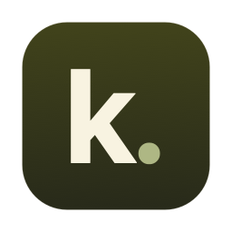
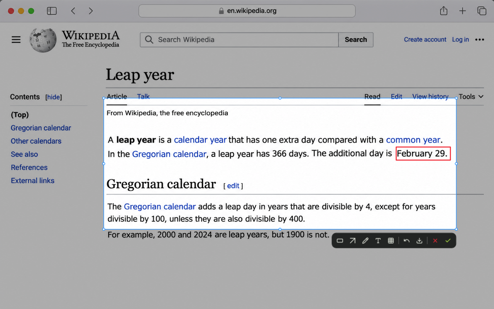
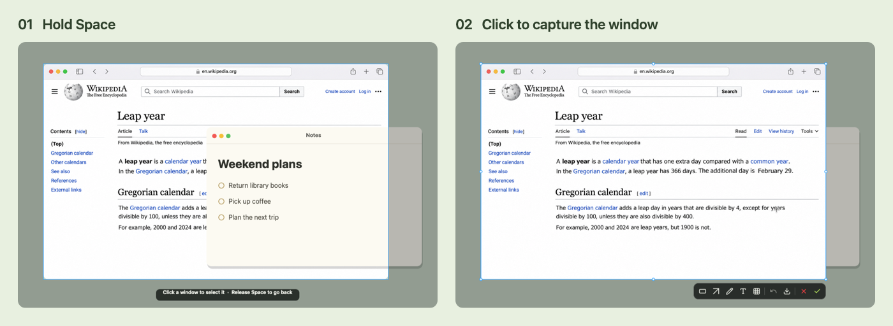
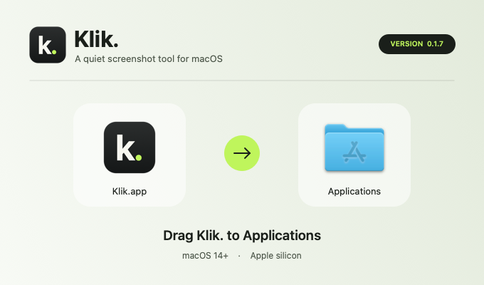
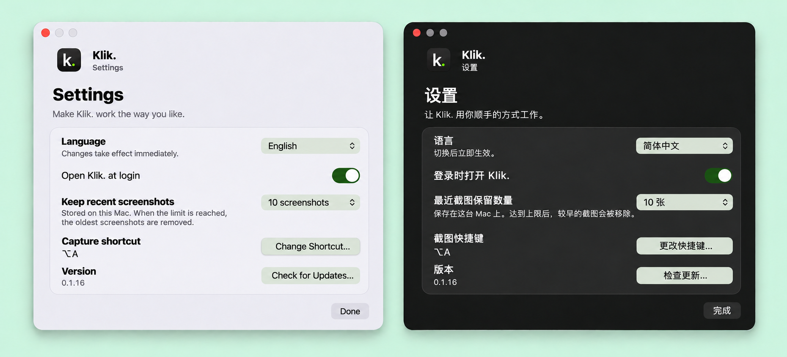

<p align="center">
  
</p>
<h1 align="center">Klik.</h1>
<p align="center">随手截一张，思路不断。</p>
<p align="center">
  <a href="README.md">English</a> ·
  <a href="CHANGELOG.md">更新日志</a> ·
  <a href="https://github.com/TerryZheng233/Klik./releases/latest">下载 DMG</a> ·
  Apple 芯片 · macOS 14+
</p>

不管你是在读论文、浏览网页，还是玩游戏，看到想截下的画面时，按 **⌥A** 框选，再按 **Enter**。截图就进了剪贴板，你可以接着做手头的事。

## 为什么做 Klik.

我喜欢微信的截图功能，用起来很顺手。只是每次确认截图后，界面都会切回微信。读东西正入神，或者游戏打到一半的时候，思路就这么被打断了。Mac 自带截图默认会把图片存到桌面，很多时候我只是想粘贴一张图，回头桌面却攒了一堆截图。

我想要一个简单的 Mac 小工具，平时待在后台，需要时按一下快捷键就能叫出来。截图后可以画个框、加根箭头、写几个字，或者给一部分画面打上马赛克，然后直接复制分享。想把图片留下来时，也可以存一份 PNG 到「下载」。



## 截一块、截整屏或截窗口

| 怎么操作 | 会发生什么 |
| --- | --- |
| **拖动** | 框选屏幕的一部分。想微调就拖边缘或四角 |
| **单击** | 选中鼠标所在的整块显示器 |
| **按住空格并单击** | 选中一个窗口，连被挡住的部分也能截到 |
| **双击** | 复制当前选区。按住空格双击窗口，可以直接复制窗口截图 |
| **Enter** 或 **✓** | 把带标注的截图复制到剪贴板 |
| **「下载 PNG」按钮（↓）** | 把 PNG 存到「下载」 |
| **Esc** 或 **×** | 取消截图 |
| **⌘Z** | 撤销上一笔标注 |
| **⇧⌘Z** | 重做刚刚撤销的标注 |

想截被挡住的窗口，按住**空格**，把鼠标移到窗口露出来的部分。点一下，整个窗口就会出现在选区里。框选或调整边界时会出现放大镜，方便对准细节。没有选中标注工具时，把鼠标移到选区内就可以拖动选区。如果连接了多台显示器，把鼠标移到想截图的屏幕即可。

有些应用的窗口可能无法出现在截图中。在部分 Mac 上，微信即使显示在屏幕上，也可能遇到这种情况。



## 安装 Klik.

1. 打开[最新 DMG](https://github.com/TerryZheng233/Klik./releases/latest)，把 **Klik.app** 拖进「应用程序」。
2. 打开 Klik.，按 **⌥A**。macOS 会提示授予「屏幕与系统音频录制」权限。授权后，如果系统提示重新打开 Klik.，照做后再试。
3. 先练习截一张。引导会在工具栏旁告诉你每个按钮怎么用。截完可以保留 **⌥A**，也可以录一组顺手的快捷键。

<p align="center">
  
</p>

点击菜单栏上的 **k.** 图标，可以打开设置或查看最近截图。截图记录保存在这台 Mac 上，点选一张可以预览和重新复制，也可以一键清空。在设置里可以选择保留 5、10、20 或 50 张，并开启登录时启动。达到数量上限后，最早的截图会被移除。

如果 **⌥A** 已被微信或其他应用占用，可以在首次设置或之后的设置中换一组快捷键；两个应用可能无法同时使用同一组快捷键。

设置里还可以修改快捷键，或在「语言」里选择「跟随系统」「English」或「简体中文」。引导和设置会跟随 Mac 的浅色或深色外观，点「练习截图…」可以再走一遍引导。



## 让 Agent 帮忙安装

把下面这段话发给能操作你这台 Mac、并能访问 GitHub 的 Agent：

```text
请从下面的页面下载最新版本，在这台 Mac 上安装 Klik.：
https://github.com/TerryZheng233/Klik./releases/latest

1. 确认这台 Mac 使用 Apple 芯片，系统是 macOS 14 或更新版本。找到最新 Release，下载 DMG 和对应的 SHA-256 校验文件。如果无法访问 Release 或找不到这两个文件，请告诉我遇到了什么问题。下载后核对 DMG，校验不符就停止。
2. 打开 DMG，把 Klik.app 复制到「应用程序」，确认安装版本与 Release 一致，再推出安装盘。如果已经装过 Klik.，替换前先问我。
3. 指导我首次打开。如果 macOS 拦截应用，请参考 Apple 的相关说明告诉我怎么操作，由我决定是否继续。保留系统原有的安全设置。
4. 帮我试用截图快捷键，并在系统提示时由我授予屏幕录制权限。如果快捷键已被占用，帮我换一组。
```

## 从源码构建

构建需要 Swift 5.10 或更新版本，以及 macOS 15 或更新版本的 SDK。

```sh
swift test
./build-app.sh
open -g .build/Klik.app
```

如果 iCloud 云盘或其他同步服务添加的 Finder 元数据导致签名校验失败，可指定一个不同步的输出目录，例如运行 `./build-app.sh "$(mktemp -d /tmp/klik-build.XXXXXX)"`。

GitHub 上的 DMG 使用临时签名，未经 Apple 公证。macOS 可能拦住首次打开，也可能在更新后再次询问屏幕录制权限。如果本机钥匙串只有一个 **Apple Development** 签名身份，构建脚本会用它签名。也可以通过 `KLIK_SIGN_IDENTITY` 自己指定。更新本机签名版时，沿用同一个身份有助于保留原来的授权。[Apple 代码签名要求](https://developer.apple.com/documentation/technotes/tn3127-inside-code-signing-requirements)

用 [dmgbuild](https://pypi.org/project/dmgbuild/1.6.7/) 制作可拖拽安装的 DMG。

```sh
KLIK_SIGN_IDENTITY=- ./build-app.sh .build/distribution
dmgbuild -s Packaging/dmg-settings.py \
  -D app=.build/distribution/Klik.app -D background=Packaging/background.png \
  'Klik.' Klik-build-arm64.dmg
```

工具栏图标来自 [Lucide](https://lucide.dev/icons/)，[许可文件](Resources/Lucide/LICENSE)随源码附上。
